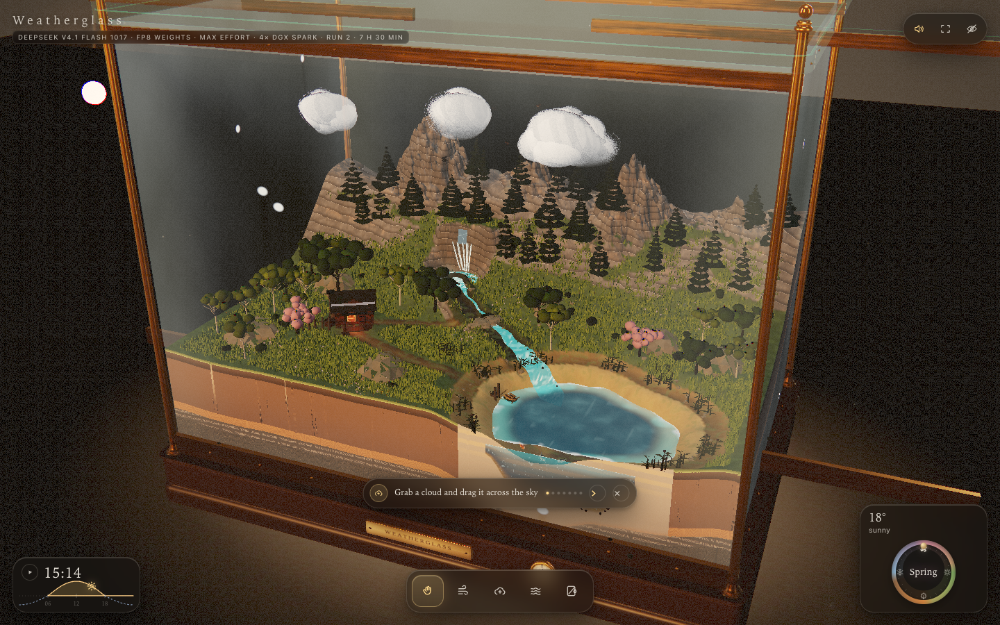

# Weatherglass — DeepSeek V4.1 Flash 1017 (FP8 · Max Effort · 4× DGX Spark · run 2)

**A self-contained interactive 3D weather toy — a living miniature landscape sealed inside a brass-and-glass display case on a walnut plinth.**

> ### ✅ This version
> **Model:** DeepSeek **V4.1 Flash 1017**
> **Weights:** **FP8**
> **Effort:** **Max** (multi-agent, 7 workers)
> **Hardware:** **4× DGX Spark**
> **Session:** experiment **run 2**, **7 h 30 min** of continuous build & polish
>
> **Live:** https://todsawat.github.io/weatherglass-DS41Flash-FP8-Max/
>
> Single HTML file. Zero external images, models, fonts or audio — every texture, mesh, sound and UI element is generated in code at runtime.

## Two separate builds

| Build | Model / weights | Hardware | Time | Repo |
|---|---|---|---|---|
| **This one** | DeepSeek V4.1 Flash 1017 · FP8 · Max effort | 4× DGX Spark | 7 h 30 min (run 2) | this repo |
| Other build | GLM5.3 Flash · EXL3 · 4 bpw · Max | 2× DGX Spark | 55 min | [weatherglass-GLM5.3Flash-EXL3-4bpw-Max](https://github.com/todsawat/weatherglass-GLM5.3Flash-EXL3-4bpw-Max) |

The two repositories, Pages sites and READMEs are deliberately kept separate and labelled so results are not mixed.

## What it is

A 12 × 8 × 9.2 m miniature valley — mountains, waterfall, river, lake, cabin, jetty, rowboat, grass, seasonal flowers, birds, fish, fireflies — held inside a working glass case with brass posts, rails, rivets, a walnut plinth and an engraved plaque with a live humidity/temperature gauge.

Clouds are physical objects: grab them, squeeze them, shake them, fling them, smash them together to merge them. Squeeze hard enough and rain pours out. Shake one and lightning cracks inside it. Rain wets the ground, makes puddles, raises the lake and swells the waterfall. Fog pours low and drains downhill. The glass mists, beads, runs, frosts and can be wiped. Drag the sun or moon to run golden hour into night; turn the season dial through blossom, summer, leaf fall and snow.

## Controls

- **Drag** empty space — orbit. **Right-drag** — orbit. **Middle-drag** — pan. **Scroll / pinch** — zoom.
- **Hand (1):** drag a cloud; **hold still** to squeeze rain (or **scroll over it**); **shake** it for lightning; **release while moving** to fling; push one cloud into another to merge. Drag the **sun** or **moon**, pull trees, click the lake, tap the glass, tap the brass gauge.
- **Wind (2):** sweep across the land. **Cloud (3):** press in the sky to condense, hold to grow. **Fog (4):** brush mist into the valley. **Wipe (5):** rub the glass clean.
- **`1`–`5`** or **`H W C F G`** — tools. **`U`** — hide/show the interface.
- The bottom-left curve scrubs the 24-hour clock; the bottom-right dial turns the year.

### Scenarios

Append `?scenario=` to the URL:
`calm` · `rain` · `storm` · `snow` · `mountainsnow` · `fog` · `autumn` · `night` · `dusk`

Example: https://todsawat.github.io/weatherglass-DS41Flash-FP8-Max/?scenario=storm

## Notes

- `index.html` is the whole app; WebGL2 is required. Desktop and mobile (responsive canvas, touch drawer, two-finger zoom/orbit).
- Detail is auto-tiered from measured frame time; lower tiers reduce counts but never remove a system.
- Landscape generation is seeded and identical on every load.
- Source, build script, brief and verification harness are included (`src/`, `build.mjs`, `PROMPT.md`, `docs/`, `tools/`). Run `node build.mjs` to rebuild `../index.html` after editing source.
- No network requests at runtime; open the file locally and it works offline.